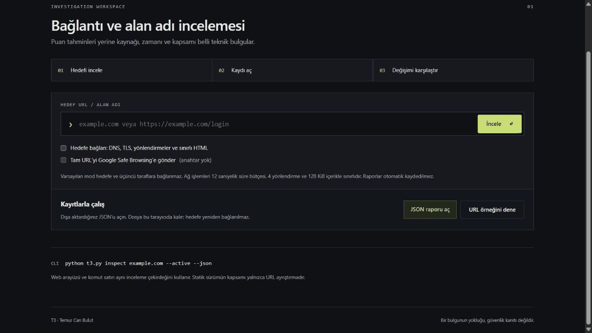

<p align="center">
  <a href="https://github.com/temurcanbulut/t3-phishing-detection/actions/workflows/ci.yml"></a>
  
  
</p>

<h1 align="center">T3 · URL & Domain Inspector</h1>
<p align="center">Inspect a link. Keep the observations. Compare what changed.<br>A local investigation workspace with a CLI, timestamped evidence and portable JSON reports.</p>
<p align="center"><a href="README.tr.md">Türkçe</a> · <a href="#start">Start</a> · <a href="docs/TECHNICAL.md">Technical reference</a> · <a href="docs/ROADMAP.md">Roadmap</a></p>



The recording uses the real local application and example.com. The optional threat provider is not configured. [Still image](docs/images/inspector.png) · [Mobile](docs/images/mobile.png).

## What you can do

- **See the actual destination.** Separate the entered URL, ASCII host and registrable domain before inspecting a link.
- **Choose when to connect.** Passive mode parses locally. Active mode collects public DNS, TLS, redirect and bounded HTML observations.
- **Inspect the source of a finding.** Every probe has a status, time, data and an explanation. Missing or incomplete checks stay visible.
- **Keep a record.** Export JSON, reopen it without contacting the target, and inspect the original observation date and file hash.
- **Compare two visits.** Load an earlier report for the same URL. See changed probes and scope changes; collection timestamps alone are ignored. Export the difference as JSON.
- **Use the same core from a terminal.** Inspect a target or compare saved reports in scripts.

T3 does not produce a phishing probability or certify that a website is safe. HTTPS, DNS and page content can be controlled by a malicious operator. A Google Safe Browsing match, when explicitly enabled, is attributed to that source; no match is not a safety verdict.

## Start

Python 3.11 or newer. Clone this repository, then:

```sh
python -m venv .venv
```

Activate `.venv\Scripts\Activate.ps1` in PowerShell, or `source .venv/bin/activate` on Linux/macOS:

```sh
python -m pip install -r requirements-audited.txt
python T3-Phishing-Detection/app.py
```

Open **http://127.0.0.1:5000**. Enter a URL and press **İncele**. Check **Hedefe bağlan** to request network evidence. **URL örneğini dene** opens an offline URL-only example. Close the terminal with `Ctrl+C` when done.

## A typical investigation

1. Inspect `example.com` in passive mode to check the host and URL structure.
2. Enable active checks to collect DNS, TLS and HTTP/HTML facts. Expand a probe to inspect its data.
3. Export the report. Later, use **JSON raporu aç** to inspect that saved observation locally.
4. With the later report open, choose **Önceki JSON'u seç**. Read the scope warning before interpreting differences.

Imported files stay in browser memory. Both the local UI and static build support import/comparison. Files must be UTF-8 T3 reports, at most 4 MiB; structure, schema, target host and evidence IDs are validated. Reports are untrusted data, not authenticated evidence. HTML-like values are rendered as text. Opening a report does not follow embedded URLs.

## Command line

```sh
python t3.py inspect example.com
python t3.py inspect https://example.com/login --active --output before.json
python t3.py inspect https://example.com/login --active --output after.json
python t3.py compare before.json after.json
```

`--json` prints structured output. `--output` writes a new file and refuses to overwrite an existing one. The CLI comparator accepts Python `t3-evidence/1` records; the browser also compares its own distinct `t3-browser-url/1` records. Different schemas and different normalized URLs cannot be compared in the UI.

## Boundaries that matter

| Mode | Works | Does not establish |
|---|---|---|
| Passive local | URL parsing, bundled public-suffix lookup | Site ownership or intent |
| Active local | Bounded DNS, verified TLS, redirect chain, source HTML form facts | JavaScript behavior, account flows or a phishing verdict |
| Optional provider | Attributed Safe Browsing URL match | Guaranteed detection or proof of safety on no-match |
| Static build | Browser URL parsing, local saved-report viewing and comparison | Live DNS, TLS, HTTP or threat checks |

Active probes allow standard HTTP/HTTPS ports and public target addresses only, revalidate redirects, pin checked DNS answers, limit body collection to 128 KiB and use a 12-second budget. The interface binds to localhost. It has no public multi-user deployment support. [Full transport, parser and privacy boundaries](docs/TECHNICAL.md).

## Optional threat lookup

Set `SAFE_BROWSING_API_KEY` in the process environment and explicitly enable the provider option. The normalized URL including its query is sent to Google. A key alone does not trigger submission. See [.env.example](.env.example) and the [provider setup and privacy notes](docs/TECHNICAL.md#third-party-lookup-and-privacy).

## Development

```sh
python -m pip install -r requirements-dev.txt
python -m ruff check .
python -m unittest discover -s tests -v
node --test tests/test_static.mjs
python tools/build_site.py
```

The current local run passes 60 Python and 7 JavaScript tests. These verify transport, parsing, report boundaries and comparison, not phishing detection accuracy. CI covers Windows/Linux and Python 3.11/3.13. A real provider-key integration remains unverified.

[Contributing](CONTRIBUTING.md) · [Security](SECURITY.md) · [Changelog](CHANGELOG.md) · [Third-party notices](THIRD_PARTY_NOTICES.txt)
