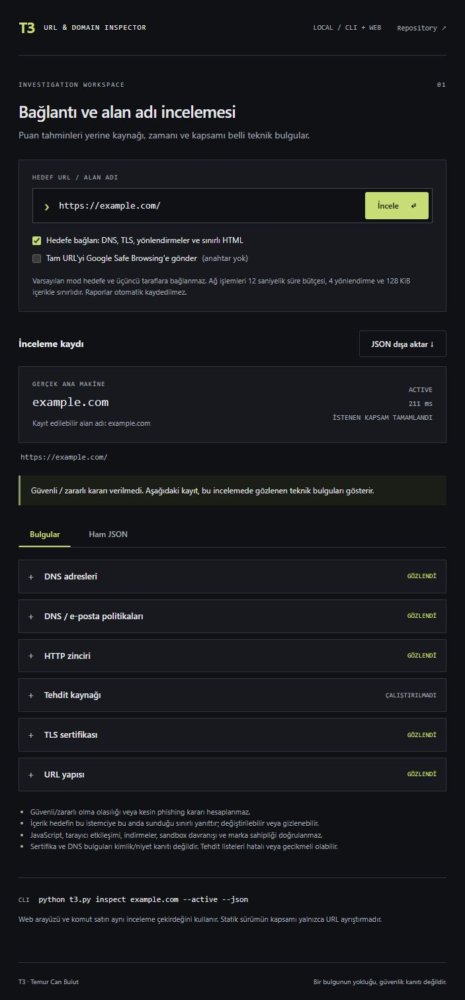

# T3 · URL & Domain Inspector

Local CLI and web tools for collecting attributable URL/domain evidence. The project no longer turns HTTPS, domain age or URL length into a phishing probability. There is **no safe/unsafe score**. A threat-source match is reported as a source match; an empty response is never proof of safety.



[Mobile view](docs/images/mobile.png). Screenshots show an explicitly requested example.com inspection; the optional threat provider was not enabled.

## Local setup

Python 3.11+:

```sh
python -m venv .venv
```

Activate `.venv\Scripts\Activate.ps1` in Windows PowerShell, or `source .venv/bin/activate` on Linux/macOS:

```sh
python -m pip install -r requirements.txt
python t3.py inspect example.com
python t3.py inspect https://example.com/login --active --json
python T3-Phishing-Detection/app.py
```

The web application binds to **127.0.0.1:5000** using Waitress. Passive mode performs URL parsing without contacting the target or threat providers. `--active` explicitly enables DNS, TLS, bounded HTTP/HTML and domain-policy collection. The web checkboxes have the same meaning.

`requirements-audited.txt` records the exact runtime dependency versions tested on Windows/Python 3.12. Install it instead of `requirements.txt` to reproduce that dependency snapshot. Upgrade the package installer first with `python -m pip install --upgrade pip`. The html5lib 1.1 tokenizer adapter is deliberately pinned; its resource guards and upstream API use must be reviewed before a parser upgrade.

## Evidence collected

| Probe | Recorded facts | Interpretation limits |
|---|---|---|
| URL | Actual ASCII/Unicode host, registrable domain from bundled PSL snapshot, scheme | No brand ownership or intent inference |
| DNS | A/AAAA addresses, collection time | System resolver response; no DNSSEC validation |
| Domain policies | Published CAA, MX and SPF/DMARC TXT records | No SPF-chain evaluation, DMARC alignment or CAA inheritance verification |
| TLS | Verified hostname/chain, issuer, validity, SHA256 certificate fingerprint, protocol/cipher and connected IP | A valid certificate does not prove a trustworthy site |
| HTTP | Redirect chain, status/selected headers, bounded-body hash and truncation | The target may serve different or changing content |
| HTML | HTML5 source parsing, declared form owners, submit-button overrides, password-field counts, title/encoding | No JavaScript execution, interaction, downloads or browser sandbox analysis |
| Optional provider | Google Safe Browsing query time, matching URL/type, no-match/unavailable states | Provider verdicts may be stale or wrong |

Cross-host or non-HTTPS credential form actions and HTTPS downgrades are source observations. They do not constitute a definitive phishing verdict. The parser handles external form controls, disabled fieldsets, inert templates and document base URLs. Backslash/invalid action declarations are reported as unresolved. Source HTML cannot establish JavaScript submissions, shadow DOM, custom-element behavior or browser interactions.

## Third-party lookup and privacy

Set `SAFE_BROWSING_API_KEY` in the process environment, then **explicitly** request `--threat-lookup` or check the web option. An environment key alone does not enable submission. The **full normalized URL including query parameters** is sent to Google. Avoid private account links/tokens. Fragments are removed. `.env.example` documents the setting; `.env` is not automatically loaded.

```powershell
$env:SAFE_BROWSING_API_KEY = 'your-key'
python t3.py inspect https://example.com/path --threat-lookup --json
```

Review the provider's [API documentation](https://developers.google.com/safe-browsing/v4/lookup-api) and [terms](https://developers.google.com/safe-browsing/v4/terms). Reports are not automatically stored. `--output report.json` saves to a new file; JSON export in the web UI saves locally. The report may contain sensitive target URLs or form actions, so review it before sharing.

## Egress and resource boundaries

- Standard HTTP/HTTPS ports only; credentials, ambiguous numeric hosts and private/reserved/transition IPs are rejected.
- Every target DNS answer must be public. Checked addresses are pinned within a report; redirect destinations are checked before connecting. HTTP cookies, ambient proxy settings and `.netrc` are not used.
- Four target redirects, 128 KiB final HTTP body, bounded headers and an overall 12-second asynchronous deadline. Compressed bodies are not decompressed or parsed. The hash covers collected bytes only, not the entire response when truncated.
- HTML tokenization and tree construction share a cooperative 0.5-second budget, with 24,000 tokens, 256 attributes per tag, 12,000 tree nodes and 128 open elements. Extracted form facts and findings each have an approximately 64 KiB serialization budget, preventing long base URLs from amplifying reports. Reached limits are explicit. Malformed-table form associations remain uncertain.
- No browser execution, subresource loads or saved target downloads. Non-HTML responses are fingerprinted only within the same byte limit. At most four analyses per process; additional requests return 429.
- Local Host/Origin restrictions and same-origin CSP defend the local web interface. The interface has no public multi-user authentication, quotas or deployment-specific network isolation; it remains a localhost tool.

The DNS resolver contacts the system's configured DNS servers, which may be local. Public-target restrictions apply to inspected web destinations. DNS policy records are returned as data; addresses/URLs inside TXT records are not followed.

The HTTP client accepts at most 64 response headers with 8 KiB line/field limits. Validated escaped paths and queries are sent without requoting; each hop records the client's serialized request URL. Waitress separately limits incoming bodies to 4 KiB, headers to 16 KiB and active connections to 32. The overall asynchronous deadline may be observed after a short, bounded synchronous parsing operation; it is not a hard real-time deadline.

Concurrent target probes share one DNS pin per host. Known NAT64 translation ranges are rejected along with private/transition addresses. TLS evidence is a separate verified connection to port 443 on the entered host; redirects are subject to the HTTP client's certificate verification and are not independent certificate-probe records.

## Compare saved observations

```sh
python t3.py inspect example.com --active --output before.json
python t3.py inspect example.com --active --output after.json
python t3.py compare before.json after.json
```

Comparison is offline, requires the same normalized target URL and highlights probe/scope changes while ignoring collection timestamps. It includes SHA256 hashes of both input files. These hashes detect byte changes relative to a saved hash; they do not authenticate the website or prove that a report was honestly produced.

## API

```sh
curl -X POST http://127.0.0.1:5000/api/analyze \
  -H 'Content-Type: application/json' \
  -d '{"url":"https://example.com/","active":true,"threat_lookup":false}'
```

The `t3-evidence/1` schema contains `target`, timestamped `evidence`, `findings`, `scope`, `partial`, `duration_ms`, `limitations` and `conclusion`. Conclusions are `no_safety_verdict` or `threat_source_match`. Inspect per-probe states; a requested check can be unavailable or bounded even when another completed.

The old GET `/check_domain` route returns 405. Use POST to keep target URLs out of request paths/logs. Legacy `score`, `risk_score`, WHOIS and ranking fields are removed.

## Static build / GitHub Pages

```sh
python tools/build_site.py
python -m http.server 5011 --bind 127.0.0.1 --directory site
```

`site/` is a functional **browser URL parser only**, using the distinct `t3-browser-url/1` schema. It does not call the Python API, resolve DNS, inspect TLS/content or contact threat services. Network controls are disabled and CSP blocks connections. It can be hosted on GitHub Pages as a limited local parser; it must never be advertised as a hosted phishing scanner. Deployment is not performed by this build.

## Verification

```sh
python -m pip install -r requirements-dev.txt
python -m ruff check .
python -m unittest discover -s tests -v
node --test tests/test_static.mjs
python -m bandit -r T3-Phishing-Detection t3.py -ll
```

The suite includes real local HTTP fixtures for slow streams, redirect loops/private redirects, body limits, compression and credential-form source parsing; DNS/provider cases are controlled fixtures. Property tests exercise invalid input and valid Unicode URL round-trips. These are transport/parser tests, **not measured phishing detection accuracy**. A real provider-key integration test remains separate.
